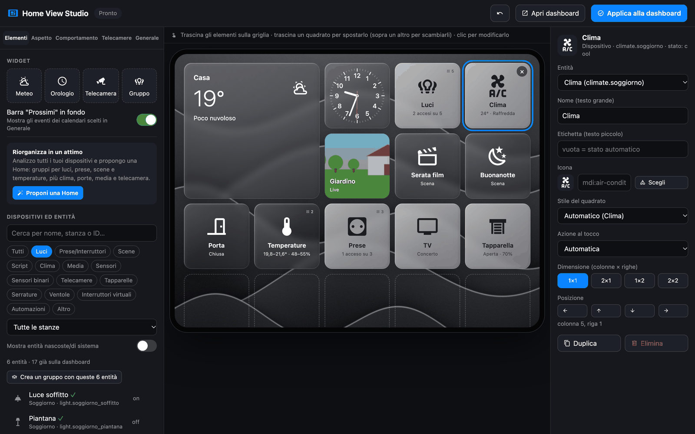
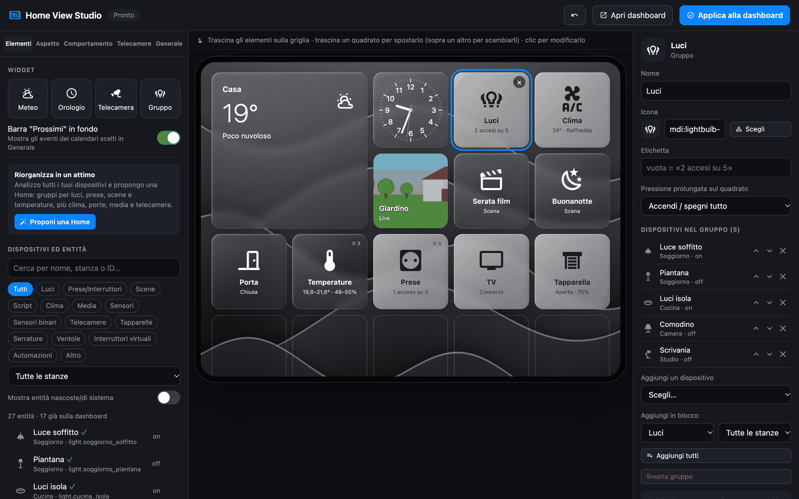
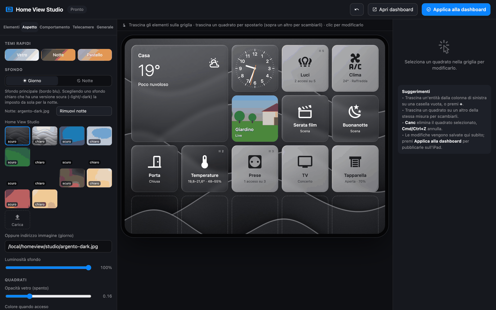
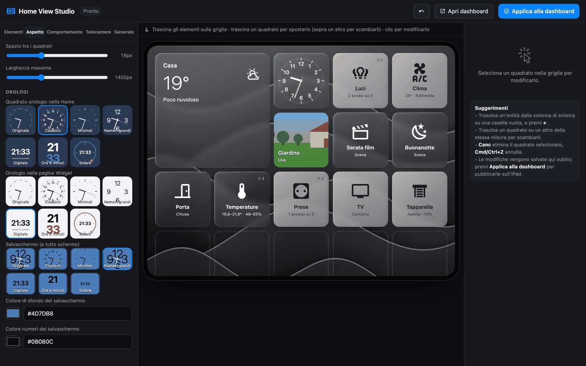
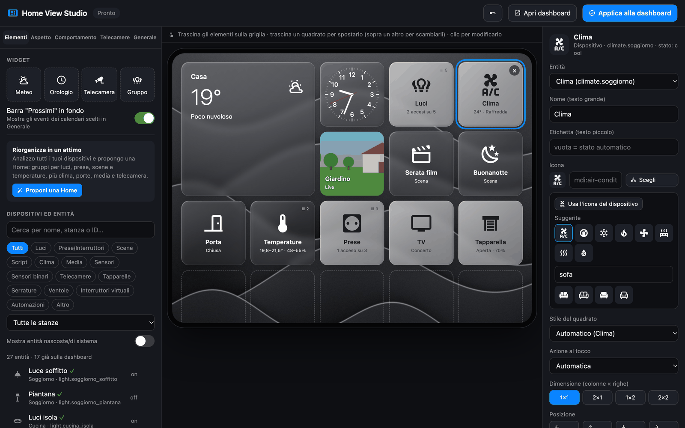
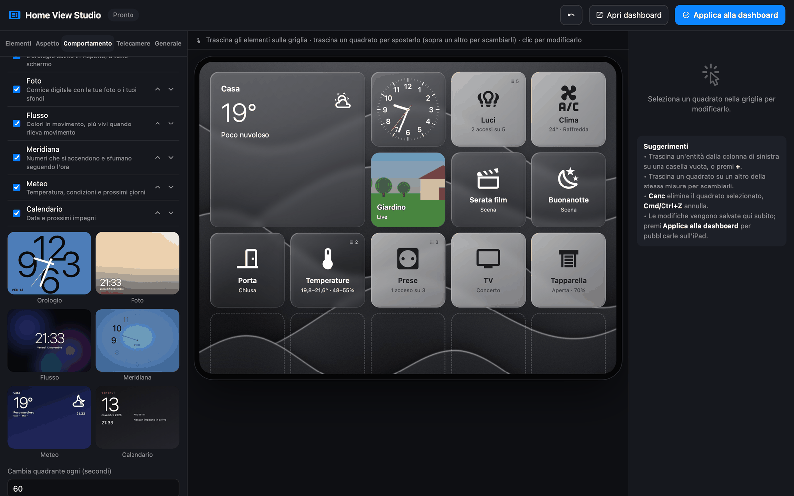
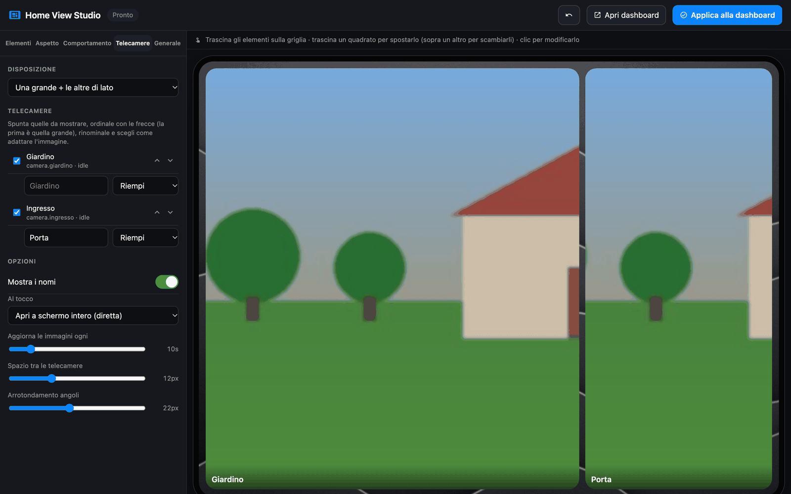
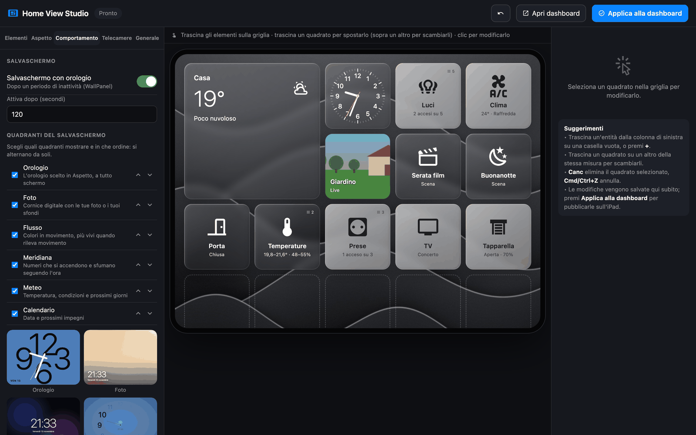
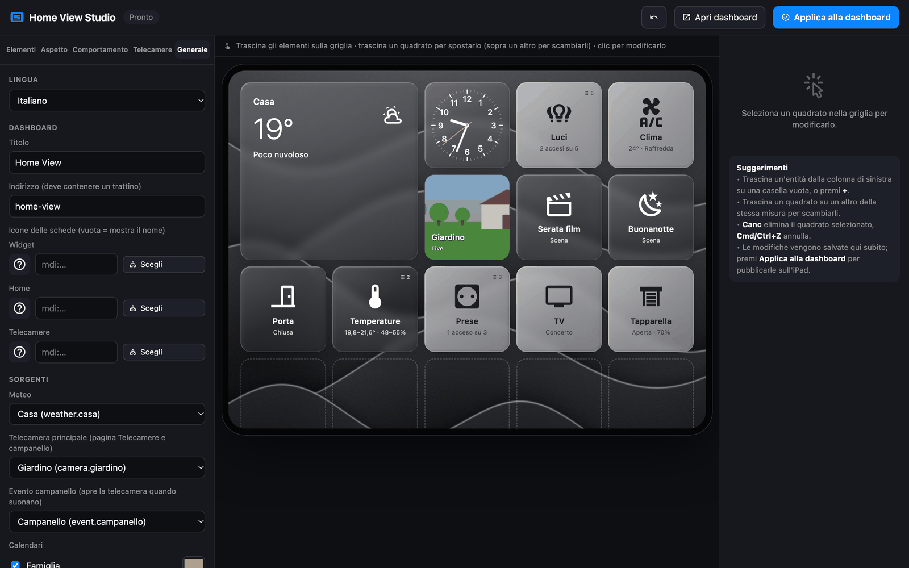
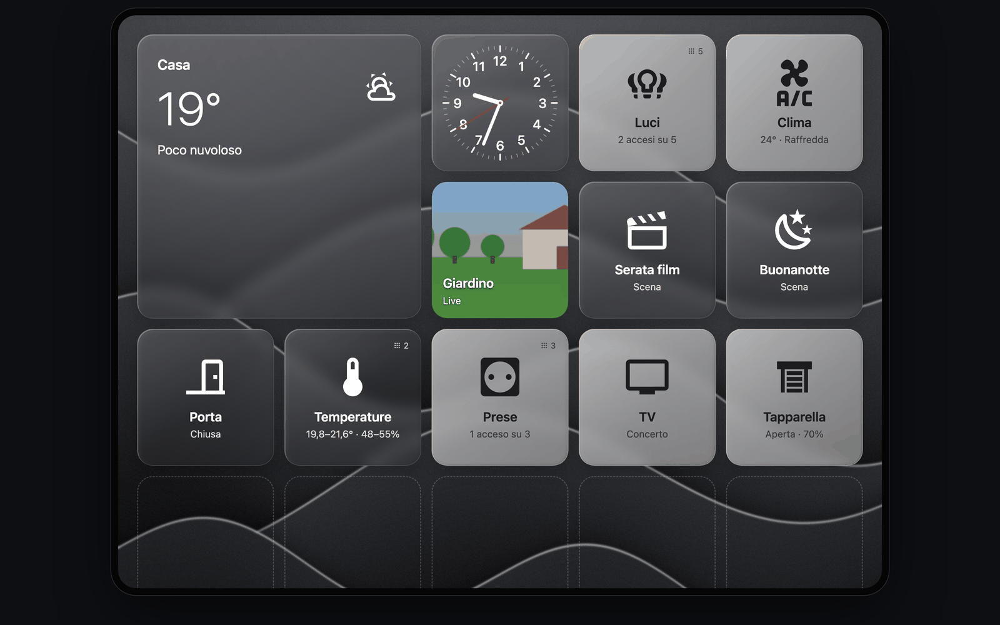

# Home View Studio

**Una dashboard per iPad in stile smart display per Home Assistant, con un editor visuale incluso.**

🇬🇧 [English](README.md) · 🇮🇹 Italiano

Home View Studio è un add-on (app) per Home Assistant. Mette a disposizione:

- una dashboard **Home View** a tre pagine (Widget · Home · Telecamere) ispirata all'aspetto del nuovo smart display Apple HomeView;
- un **editor visuale** che si apre dalla barra laterale di Home Assistant, dove scegli dispositivi, disposizione, colori, sfondi, orologi e comportamenti, senza scrivere YAML.



> **Nota:** questo progetto non è affiliato, approvato o sponsorizzato da Apple Inc.
> "Apple", "HomeView" e "iPad" sono marchi di Apple Inc. Il nome viene usato solo per descrivere lo stile a cui si ispira la dashboard.

---

## Indice

1. [Cosa puoi fare](#cosa-puoi-fare)
2. [Screenshot](#screenshot)
3. [Requisiti](#requisiti)
4. [Tutorial: installazione passo per passo](#tutorial-installazione-passo-per-passo)
5. [Tutorial: creare la tua dashboard](#tutorial-creare-la-tua-dashboard)
6. [Configurare l'iPad](#configurare-liPad)
7. [Domande frequenti e problemi](#domande-frequenti-e-problemi)
8. [Come funziona](#come-funziona)
9. [Fonti e ringraziamenti](#fonti-e-ringraziamenti)
10. [Licenza](#licenza)

---

## Cosa puoi fare

| Area | Funzioni |
|---|---|
| **Elementi** | Elenco di tutte le entità di Home Assistant, con ricerca e filtri per tipo e per stanza. Le trascini sulla griglia oppure premi **+**. |
| **Quadrati** | Nome, etichetta, icona, stile (luce, porta, clima, media, sensore, tapparella, serratura, ventola…), azione al tocco e dimensione (1×1, 2×1, 1×2, 2×2). |
| **Proponi una Home** | Con un clic analizzo tutti i tuoi dispositivi e propongo una Home completa: gruppi per luci, prese, scene e temperature (più un gruppo per ogni stanza con più luci), clima, porte, media e telecamera. Salto le scene dei telecomandi e gli interruttori interni delle telecamere. La tieni, la ritocchi o torni a prima. |
| **Gruppi** | Un quadrato che raggruppa più dispositivi, per esempio "tutte le luci" o "tutte le prese del soggiorno". Mostra "2 accesi su 5". Il **tocco** apre un popup con tutti i dispositivi e i pulsanti *Accendi tutto / Spegni tutto*. La **pressione prolungata** accende o spegne tutto il gruppo. |
| **Widget** | Meteo (2×2), orologio, telecamera live, barra "Prossimi" con gli eventi dei calendari. |
| **Orologi** | 6 quadranti (Classico, Minimal, Numeri grandi, Digitale, Ore e minuti, Solare) più l'originale. Si scelgono separatamente per il quadrato della Home, per la pagina Widget e per il salvaschermo. |
| **Sfondi** | 7 sfondi originali inclusi (chiari e scuri), più i tuoi, caricabili dall'editor. Puoi scegliere uno sfondo diverso **per la notte**, che cambia da solo al tramonto. |
| **Aspetto** | Temi rapidi, colore dei quadrati accesi, opacità e sfocatura del vetro, arrotondamento, ombre, dimensioni di testi e icone, numero di colonne (da 3 a 8). |
| **Quadranti del salvaschermo** | Sei quadranti originali che si alternano quando l'iPad è inattivo: Orologio, Foto (la tua cartella di foto o gli sfondi), Flusso (colori in movimento che si accendono con un sensore di movimento), Meridiana (numeri che sfumano con l'ora), Meteo e Calendario. La modalità notte scurisce e scalda lo schermo. |
| **Comportamento** | Salvaschermo (WallPanel), schermo intero, modalità kiosk, scorrimento tra le pagine anche col mouse, animazioni, pagine visibili. |
| **Telecamere** | Una scheda dedicata con anteprima: scegli quali telecamere mostrare e in che ordine, rinominale, scegli se l'immagine riempie o è intera e la disposizione (automatica, griglia da 1 a 4 colonne, oppure una grande con le altre di lato). In più nomi sì/no, azione al tocco (diretta a schermo intero, dettagli o niente), frequenza di aggiornamento, spazi e arrotondamento. |
| **Lingua** | Interfaccia e dashboard in **italiano** o **inglese**, in automatico come Home Assistant oppure a scelta in *Generale → Lingua*. |
| **Sicurezza** | Prima di ogni pubblicazione viene salvata una copia della dashboard, ripristinabile dall'editor. |

## Screenshot

| Elementi e griglia | Gruppo di dispositivi |
|---|---|
|  |  |
| **Aspetto e sfondi** | **Orologi (Home, Widget, salvaschermo)** |
|  |  |
| **Selettore icone** | **Quadranti del salvaschermo** |
|  |  |
| **Pagina Telecamere** | **Comportamento** |
|  |  |
| **Generale: sorgenti, lingua, ripristino** | |
|  | |



> Gli screenshot usano una **casa demo** con dispositivi inventati. La telecamera mostra un'immagine disegnata, non una ripresa reale.

## Requisiti

- **Home Assistant OS** o **Supervised**, perché serve il supporto agli add-on. Testato con Home Assistant 2026.10 e Supervisor 2026.11.
- **HACS** installato ([guida ufficiale](https://hacs.xyz/docs/use/)).
- Queste card frontend, da installare da HACS:

| Card | Autore | Link |
|---|---|---|
| button-card | custom-cards | https://github.com/custom-cards/button-card |
| Bubble Card | Clooos | https://github.com/Clooos/Bubble-Card |
| WallPanel | j-a-n | https://github.com/j-a-n/lovelace-wallpanel |
| Home Assistant Swipe Navigation | zanna-37 | https://github.com/zanna-37/hass-swipe-navigation |
| Kiosk Mode | NemesisRE | https://github.com/NemesisRE/kiosk-mode |
| card-mod | thomasloven | https://github.com/thomasloven/lovelace-card-mod |

- Facoltativi: un'entità **meteo** (va bene l'integrazione Met.no predefinita), uno o più **calendari**, una o più **telecamere**.

## Tutorial: installazione passo per passo

### 1. Installa le card da HACS

1. Apri **HACS** nella barra laterale.
2. Cerca e scarica, una alla volta: *button-card*, *Bubble Card*, *WallPanel*, *Swipe Navigation*, *Kiosk Mode*, *card-mod*.
3. Quando HACS lo chiede, ricarica la pagina del browser.

### 2. Aggiungi questo repository all'Add-on Store

1. Vai in **Impostazioni → App** (nelle versioni meno recenti: *Componenti aggiuntivi*) **→ Store**.
2. Apri il menu **⋮** in alto a destra e scegli **Repository**.
3. Incolla l'indirizzo di questo repository:
   ```
   https://github.com/gioromeo-dev/ha-applehomeview-dashboard
   ```
4. Premi **Aggiungi** e chiudi la finestra.

[](https://my.home-assistant.io/redirect/supervisor_add_addon_repository/?repository_url=https%3A%2F%2Fgithub.com%2Fgioromeo-dev%2Fha-applehomeview-dashboard)

### 3. Installa e avvia Home View Studio

1. Nello Store compare **Home View Studio**: aprilo e premi **Installa**. La prima volta Home Assistant costruisce l'immagine, e servono 1-3 minuti.
2. Premi **Avvia**.
3. Attiva **Mostra nella barra laterale**.
4. Premi **Apri interfaccia web**, oppure clicca *Home View Studio* nella barra laterale.

### 4. (Facoltativo) Usa altri sfondi

Oltre a quelli inclusi puoi usare qualsiasi sfondo. Per esempio, l'articolo di iSpazio [*Sfondi Apple HomeView – download*](https://www.ispazio.net/2288953/sfondi-apple-homeview-download) mette a disposizione gli sfondi di HomeView (chiari e scuri) da scaricare per uso personale.

1. Scarica sul tuo computer le immagini che vuoi.
2. Nell'editor apri **Aspetto** e premi **Carica**.
3. Se carichi una coppia chiamata `nome-light.jpg` / `nome-dark.jpg`, di notte viene usata da sola quella scura.

> Questi sfondi appartengono ai rispettivi proprietari e non fanno parte del progetto: scaricali tu, per uso personale.

## Tutorial: creare la tua dashboard

1. **Elementi:** trascina sulla griglia i dispositivi che vuoi. Puoi filtrarli per tipo (*Luci*, *Prese*, *Scene*…) o per stanza.
2. **Gruppi:**
   - filtra per esempio per *Luci* e premi **Crea un gruppo con queste entità**;
   - oppure trascina il widget **Gruppo** sulla griglia e aggiungi i dispositivi dal pannello a destra: uno alla volta, "in blocco" per tipo e stanza, o trascinandoli sopra il quadrato.
3. **Clic su un quadrato** per modificarlo: nome, etichetta, icona, stile, azione, dimensione.
   - Trascina un quadrato sopra un altro della stessa misura per scambiarli.
   - **Canc** lo elimina, **Cmd/Ctrl+Z** annulla.
4. **Aspetto:** scegli lo sfondo di giorno e di notte, i colori e gli orologi.
5. **Comportamento:** salvaschermo, kiosk, scorrimento.
6. **Generale:**
   - nome e indirizzo della dashboard (per esempio `home-view`);
   - meteo, calendari e telecamere da usare;
   - lingua dell'interfaccia e della dashboard;
   - copie di ripristino.
7. Premi **Applica alla dashboard**. La dashboard viene creata, o aggiornata, e compare nella barra laterale.

> Le modifiche vengono salvate subito nell'add-on, ma la dashboard cambia **solo** quando premi *Applica*.
> Non modificare la dashboard dall'editor YAML di Home Assistant: verrebbe sovrascritta alla pubblicazione successiva.

## Configurare l'iPad

1. Installa l'app **Home Assistant** (Companion) oppure usa Safari.
2. Apri `http://<tuo-home-assistant>:8123/home-view/home`.
3. **Tieni premuto l'orologio** per attivare o disattivare la modalità kiosk, che nasconde le barre. In alternativa aggiungi `?kiosk` all'indirizzo, e `?disable_km` per uscirne.
4. **Scorri a destra o a sinistra** per passare tra Widget, Home e Telecamere. Su Mac o PC puoi anche cliccare e trascinare.
5. Consigliato: in **Impostazioni iPad → Schermo e luminosità → Blocco automatico → Mai**, e usa *Accesso Guidato* per bloccare l'iPad sull'app.

## Domande frequenti e problemi

**La dashboard è vuota o mostra "Configurazione non valida" / "Custom element doesn't exist".**
Manca una delle card HACS, oppure il browser usa ancora la cache. Installa le card dei requisiti e ricarica la pagina con Cmd/Ctrl+Shift+R.

**Il meteo mostra "–" per umidità, pressione o UV.**
Dipende dall'integrazione meteo: Met.no, per esempio, non fornisce tutti i valori.

**Il calendario dice "Nessun impegno".**
Controlla in *Generale* di aver selezionato almeno un calendario con degli eventi.

**Ho cambiato qualcosa ma l'iPad non si aggiorna.**
Premi *Applica alla dashboard*, poi ricarica la pagina sull'iPad.

**Voglio tornare indietro.**
Vai in *Generale → Ripristino*: ogni *Applica* salva prima una copia della dashboard precedente (sono conservate le ultime 20).

## Come funziona

```
homeview_studio/
├── config.yaml        # manifest dell'add-on (Ingress, accesso all'API di Home Assistant, cartella /config)
├── Dockerfile         # Alpine + Python 3 + Pillow
├── run.sh             # avvio con le variabili d'ambiente del Supervisor
└── app/
    ├── server.py      # piccolo server HTTP (solo libreria standard) servito via Ingress
    ├── generator.py   # trasforma layout.json + base.json nella configurazione Lovelace
    ├── base.json      # dashboard di base (derivata dal lavoro MIT di Shane Whatley)
    ├── clock.js       # quadranti degli orologi (usati sia dall'editor sia dalla dashboard)
    └── www/index.html # l'editor visuale
```

- L'add-on legge entità, aree e dispositivi tramite la **WebSocket API** di Home Assistant, usando il token del Supervisor.
- Il tuo layout è salvato in `/data/layout.json`, dentro l'add-on, quindi viene incluso nei backup.
- **Applica** genera la configurazione e la salva con `lovelace/config/save`, sempre tramite la WebSocket API.
- Gli sfondi caricati finiscono in `/config/www/homeview/`, quelli inclusi vengono copiati in `/config/www/homeview/studio/`; sono serviti come `/local/homeview/...`.

## Fonti e ringraziamenti

**Autore**
- [@gioromeo-dev](https://github.com/gioromeo-dev)

**Design e ispirazione**
- **Apple HomeView**, lo smart display di Apple presentato a ottobre 2026. Notizie e software: [MacRumors, "HomeView software 27.2"](https://www.macrumors.com/2026/10/30/homeview-software-27-2/).
- **Shane Whatley**: [*I built my own Apple HomeView using an iPad*](https://shanewhatley.com/i-built-my-own-apple-homeview-using-an-ipad/). La dashboard di base (template `glass_tile`, meteo, calendario, orologi originali, popup, viste Widget/Home/Telecamere) deriva dal suo YAML pubblicato con **licenza MIT**. È stata adattata: tradotta in italiano e inglese, generata in modo programmatico, con quadrati, gruppi, orologi e telecamere configurabili.

**Sfondi**
- I 7 sfondi inclusi (`homeview_studio/app/wallpapers`) sono immagini originali create per questo progetto e distribuite con licenza MIT.

**Software e componenti**
- [Home Assistant](https://www.home-assistant.io/), con la [documentazione per sviluppatori di add-on](https://developers.home-assistant.io/docs/add-ons) e la [WebSocket API](https://developers.home-assistant.io/docs/api/websocket).
- [HACS](https://hacs.xyz/).
- Le card elencate nei [Requisiti](#requisiti): button-card, Bubble Card, WallPanel, Swipe Navigation, Kiosk Mode, card-mod.
- [Material Design Icons](https://pictogrammers.com/library/mdi/) di Pictogrammers, caricate nell'editor tramite [jsDelivr](https://www.jsdelivr.com/package/npm/@mdi/font) (licenza Apache 2.0).
- Immagini base degli add-on: [home-assistant/docker-base](https://github.com/home-assistant/docker-base).

## Licenza

[MIT](LICENSE). Il file `base.json` include lavoro di Shane Whatley, anch'esso con licenza MIT.
