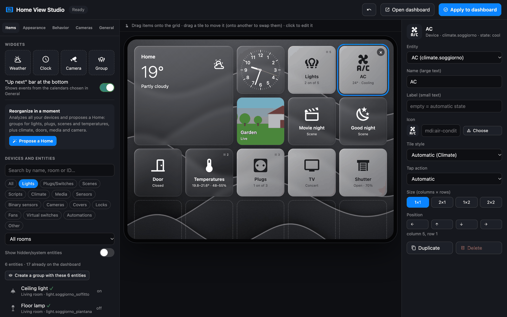
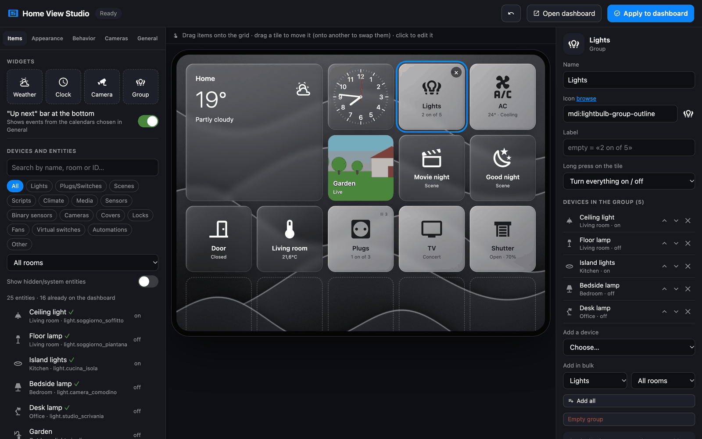
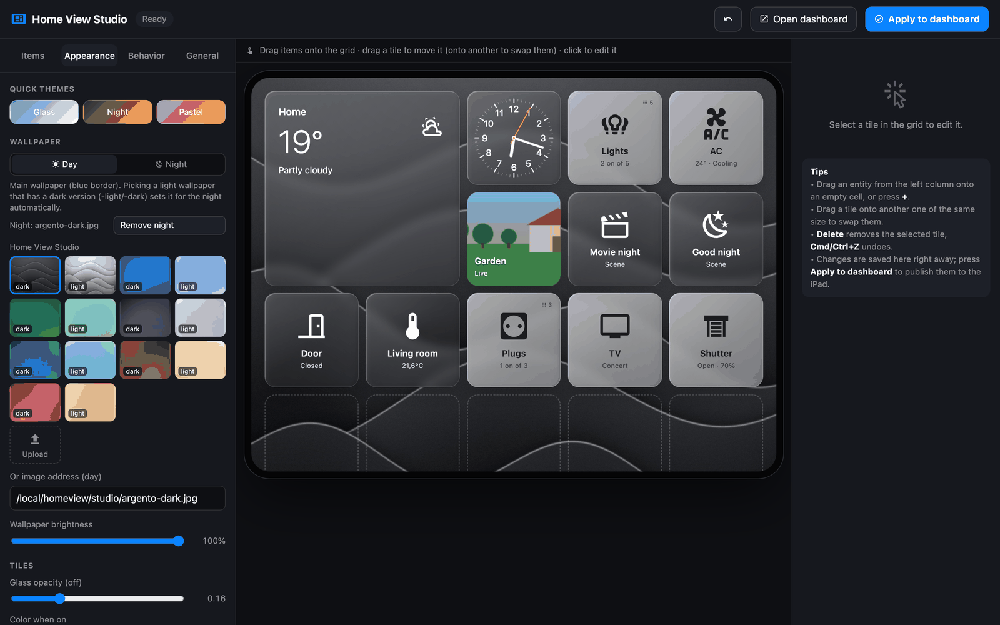
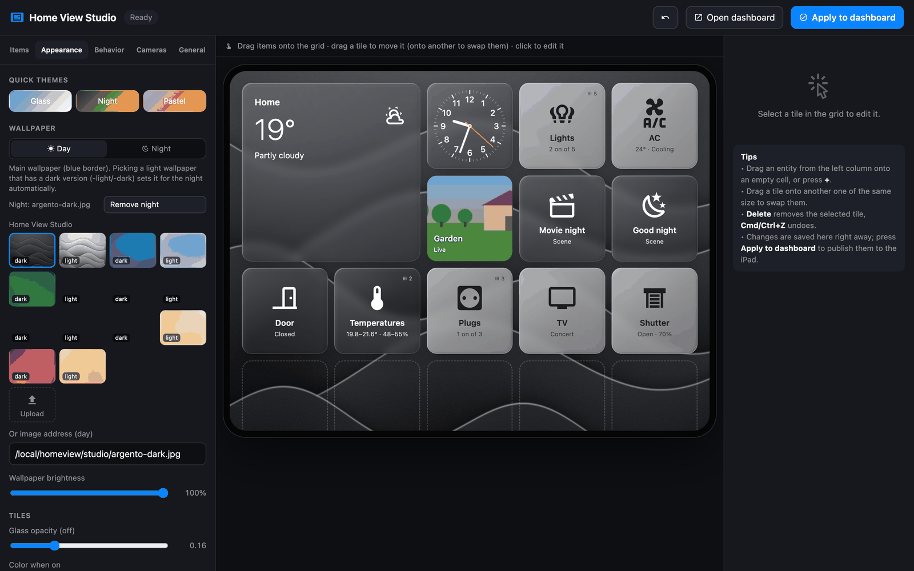
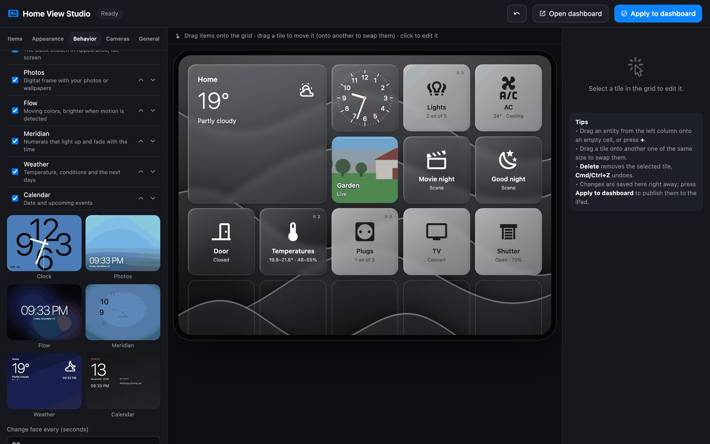
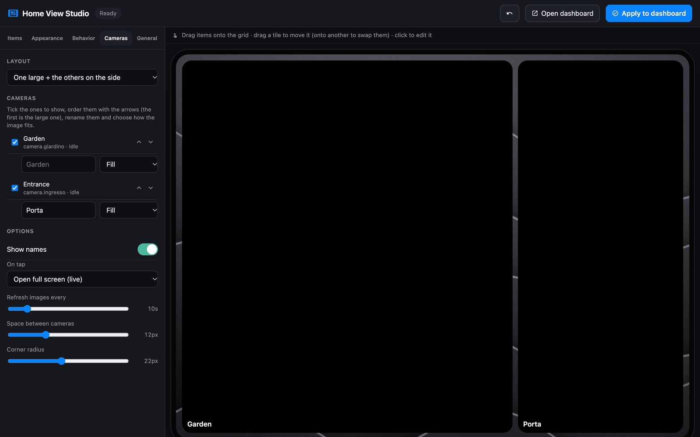
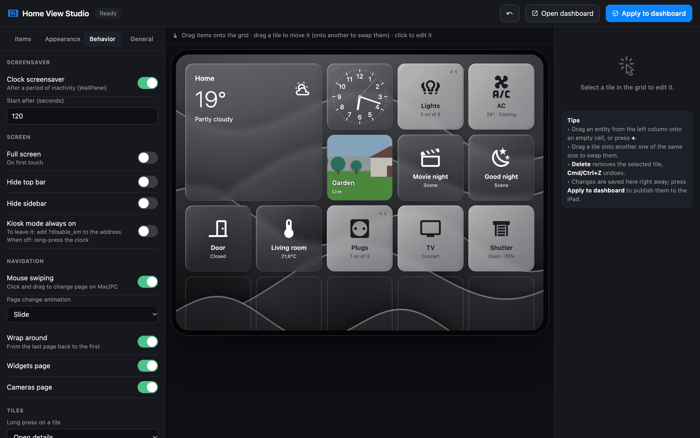
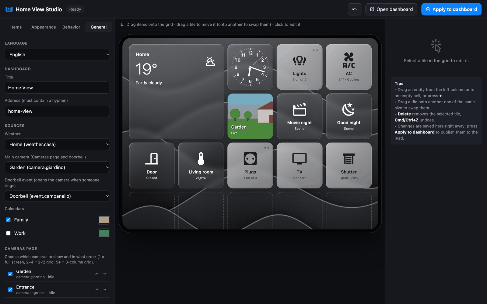
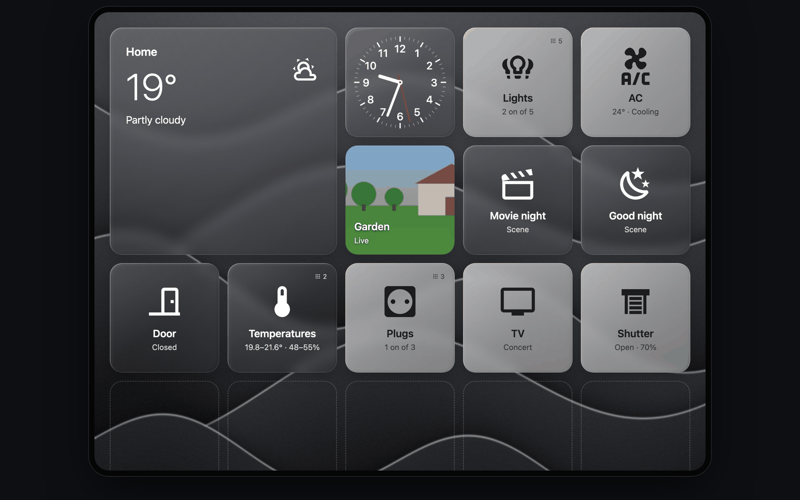

# Home View Studio

**A smart-display style iPad dashboard for Home Assistant, with a built-in visual editor.**

🇬🇧 English · 🇮🇹 [Italiano](README.it.md)

Home View Studio is an add-on (app) for Home Assistant. It provides:

- a three-page **Home View** dashboard (Widgets · Home · Cameras) inspired by the look of Apple's new HomeView smart display;
- a **visual editor** that opens from the Home Assistant sidebar, where you choose devices, layout, colors, wallpapers, clocks and behavior, with no YAML to write.



> **Note:** this project is not affiliated with, endorsed by or sponsored by Apple Inc.
> "Apple", "HomeView" and "iPad" are trademarks of Apple Inc. The name is used only to describe the style that inspired the dashboard.
>
> **Language:** the editor and the dashboard are available in **English** and **Italian**. By default they follow your Home Assistant language; you can change it in *General → Language*.

---

## Contents

1. [Features](#features)
2. [Screenshots](#screenshots)
3. [Requirements](#requirements)
4. [Tutorial: step-by-step installation](#tutorial-step-by-step-installation)
5. [Tutorial: building your dashboard](#tutorial-building-your-dashboard)
6. [Setting up the iPad](#setting-up-the-ipad)
7. [FAQ and troubleshooting](#faq-and-troubleshooting)
8. [How it works](#how-it-works)
9. [Sources and credits](#sources-and-credits)
10. [License](#license)

---

## Features

| Area | What you can do |
|---|---|
| **Items** | Browse every Home Assistant entity, with search and filters by type and by room. Drag them onto the grid or press **+**. |
| **Tiles** | Name, label, icon, style (light, door, climate, media, sensor, cover, lock, fan…), tap action and size (1×1, 2×1, 1×2, 2×2). |
| **Propose a Home** | One click analyzes all your devices and proposes a complete Home: groups for lights, plugs, scenes and temperatures (plus a group per room with several lights), climate, doors, media and camera. Remote-control scenes and camera internals are skipped. Keep it, tweak it or go back. |
| **Groups** | One tile that groups several devices, such as "all lights" or "all living-room plugs". It shows "2 on out of 5". A **tap** opens a popup with every device plus *Turn all on / Turn all off* buttons. A **long press** turns the whole group on or off. |
| **Widgets** | Weather (2×2), clock, live camera, and an "Up next" bar with your calendar events. |
| **Clocks** | 6 clock faces (Classic, Minimal, Big numerals, Digital, Hours & minutes, Solar) plus the original one. Pick one separately for the Home clock tile, the Widgets page and the screensaver. |
| **Wallpapers** | 7 original wallpapers included (light and dark), plus your own, uploaded from the editor. You can set a different **night** wallpaper that switches automatically at sunset. |
| **Appearance** | Quick themes, color of tiles that are on, glass opacity and blur, corner radius, shadows, text and icon sizes, number of columns (3 to 8). |
| **Screensaver faces** | Six original faces that rotate while the iPad is idle: Clock, Photos (your photo folder or wallpapers), Flow (moving colors that brighten when a motion sensor triggers), Meridian (numerals fading with the time), Weather and Calendar. Night mode dims and warms the screen. |
| **Behavior** | Screensaver (WallPanel), full screen, kiosk mode, swiping between pages (mouse too), animations, which pages are shown. |
| **Cameras** | A dedicated tab with a live preview: choose which cameras to show and their order, rename them, fill or fit each image, and pick the layout (automatic, grid with 1–4 columns, or one large camera with the others on the side). Also names on/off, tap action (full-screen live popup, details or nothing), refresh rate, spacing and corner radius. |
| **Language** | Editor and dashboard in **English** or **Italian**, automatic (same as Home Assistant) or chosen in *General → Language*. |
| **Safety** | A copy of the dashboard is saved before every publish, and you can restore it from the editor. |

## Screenshots

| Items and grid | Device group |
|---|---|
|  |  |
| **Appearance and wallpapers** | **Clocks (Home, Widgets, screensaver)** |
|  |  |
| **Screensaver faces** | **Cameras page** |
|  |  |
| **Behavior** | **General: sources, language, restore** |
|  |  |



> The screenshots use a **demo home** with made-up devices. The camera shows a drawn image, not real footage.

## Requirements

- **Home Assistant OS** or **Supervised**, because add-on support is needed. Tested with Home Assistant 2026.10 and Supervisor 2026.11.
- **HACS** installed ([official guide](https://hacs.xyz/docs/use/)).
- These frontend cards, installed from HACS:

| Card | Author | Link |
|---|---|---|
| button-card | custom-cards | https://github.com/custom-cards/button-card |
| Bubble Card | Clooos | https://github.com/Clooos/Bubble-Card |
| WallPanel | j-a-n | https://github.com/j-a-n/lovelace-wallpanel |
| Home Assistant Swipe Navigation | zanna-37 | https://github.com/zanna-37/hass-swipe-navigation |
| Kiosk Mode | NemesisRE | https://github.com/NemesisRE/kiosk-mode |
| card-mod | thomasloven | https://github.com/thomasloven/lovelace-card-mod |

- Optional: a **weather** entity (the default Met.no integration works), one or more **calendars**, one or more **cameras**.

## Tutorial: step-by-step installation

### 1. Install the cards from HACS

1. Open **HACS** from the sidebar.
2. Search for and download, one at a time: *button-card*, *Bubble Card*, *WallPanel*, *Swipe Navigation*, *Kiosk Mode*, *card-mod*.
3. When HACS asks, reload the browser page.

### 2. Add this repository to the Add-on Store

1. Go to **Settings → Apps** (*Add-ons* in older versions) **→ Store**.
2. Open the **⋮** menu in the top-right corner and choose **Repositories**.
3. Paste this repository's address:
   ```
   https://github.com/gioromeo-dev/ha-applehomeview-dashboard
   ```
4. Press **Add** and close the dialog.

[](https://my.home-assistant.io/redirect/supervisor_add_addon_repository/?repository_url=https%3A%2F%2Fgithub.com%2Fgioromeo-dev%2Fha-applehomeview-dashboard)

### 3. Install and start Home View Studio

1. **Home View Studio** now appears in the Store: open it and press **Install**. The first time, Home Assistant builds the image, which takes 1-3 minutes.
2. Press **Start**.
3. Turn on **Show in sidebar**.
4. Press **Open web UI**, or click *Home View Studio* in the sidebar.

### 4. (Optional) Use other wallpapers

Besides the bundled ones, you can use any wallpaper you like. For example, the iSpazio article [*Sfondi Apple HomeView – download*](https://www.ispazio.net/2288953/sfondi-apple-homeview-download) offers the HomeView wallpapers (light and dark) for personal download.

1. Download the images you want to your computer.
2. In the editor, open **Appearance** and press **Upload**.
3. If you upload a pair named `name-light.jpg` / `name-dark.jpg`, the dark one is used automatically at night.

> These wallpapers belong to their respective owners and are not part of this project: download them yourself, for personal use.

## Tutorial: building your dashboard

1. **Items:** drag the devices you want onto the grid. You can filter them by type (*Lights*, *Plugs*, *Scenes*…) or by room.
2. **Groups:**
   - filter, for example by *Lights*, and press **Create a group with these entities**;
   - or drag the **Group** widget onto the grid and add devices from the right-hand panel: one at a time, "in bulk" by type and room, or by dragging them onto the tile.
3. **Click a tile** to edit it: name, label, icon, style, action, size.
   - Drag a tile onto another one of the same size to swap them.
   - **Delete** removes it, **Cmd/Ctrl+Z** undoes.
4. **Appearance:** choose the day and night wallpapers, the colors and the clocks.
5. **Behavior:** screensaver, kiosk, swiping.
6. **General:**
   - dashboard name and address (for example `home-view`);
   - which weather, calendars and cameras to use;
   - interface and dashboard language;
   - restore copies.
7. Press **Apply to dashboard**. The dashboard is created, or updated, and appears in the sidebar.

> Your changes are saved in the add-on right away, but the dashboard changes **only** when you press *Apply*.
> Don't edit the dashboard in Home Assistant's YAML editor: it would be overwritten the next time you publish.

## Setting up the iPad

1. Install the **Home Assistant** (Companion) app, or use Safari.
2. Open `http://<your-home-assistant>:8123/home-view/home`.
3. **Long-press the clock** to turn kiosk mode, which hides the bars, on or off. Alternatively add `?kiosk` to the address, and `?disable_km` to leave it.
4. **Swipe left or right** to move between Widgets, Home and Cameras. On a Mac or PC you can also click and drag.
5. Recommended: set **iPad Settings → Display & Brightness → Auto-Lock → Never**, and use *Guided Access* to lock the iPad to the app.

## FAQ and troubleshooting

**The dashboard is empty or shows "Invalid configuration" / "Custom element doesn't exist".**
One of the HACS cards is missing, or the browser is still using its cache. Install the required cards and reload the page with Cmd/Ctrl+Shift+R.

**The weather shows "–" for humidity, pressure or UV.**
That depends on your weather integration: Met.no, for example, doesn't provide every value.

**The calendar says "Nothing on the calendar this week".**
Check in *General* that you selected at least one calendar that has events.

**I changed something but the iPad doesn't update.**
Press *Apply to dashboard*, then reload the page on the iPad.

**I want to go back.**
Go to *General → Restore*: every *Apply* first saves a copy of the previous dashboard (the last 20 are kept).

## How it works

```
homeview_studio/
├── config.yaml        # add-on manifest (Ingress, Home Assistant API access, /config folder)
├── Dockerfile         # Alpine + Python 3 + Pillow
├── run.sh             # starts the server with the Supervisor environment variables
└── app/
    ├── server.py      # small HTTP server (standard library only), served through Ingress
    ├── generator.py   # turns layout.json + base.json into the Lovelace configuration
    ├── base.json      # base dashboard (derived from Shane Whatley's MIT-licensed work)
    ├── clock.js       # clock faces (shared by the editor and the dashboard)
    └── www/index.html # the visual editor
```

- The add-on reads entities, areas and devices through the Home Assistant **WebSocket API**, using the Supervisor token.
- Your layout is saved in `/data/layout.json` inside the add-on, so it is included in backups.
- **Apply** generates the configuration and saves it with `lovelace/config/save`, also through the WebSocket API.
- Uploaded wallpapers go to `/config/www/homeview/`, and the bundled ones are copied to `/config/www/homeview/studio/`; they are served as `/local/homeview/...`.

## Sources and credits

**Author**
- [@gioromeo-dev](https://github.com/gioromeo-dev)

**Design and inspiration**
- **Apple HomeView**, Apple's smart display announced in October 2026. News and software: [MacRumors, "HomeView software 27.2"](https://www.macrumors.com/2026/10/30/homeview-software-27-2/).
- **Shane Whatley**: [*I built my own Apple HomeView using an iPad*](https://shanewhatley.com/i-built-my-own-apple-homeview-using-an-ipad/). The base dashboard (the `glass_tile` template, weather, calendar, original clocks, popups, and the Widgets/Home/Cameras views) is derived from his YAML, published under the **MIT license**. It has been adapted: translated into Italian and English, generated programmatically, and extended with configurable tiles, groups, clocks and cameras.

**Wallpapers**
- The 7 bundled wallpapers (`homeview_studio/app/wallpapers`) are original artwork generated for this project and released under the MIT license.

**Software and components**
- [Home Assistant](https://www.home-assistant.io/), its [add-on developer documentation](https://developers.home-assistant.io/docs/add-ons) and its [WebSocket API](https://developers.home-assistant.io/docs/api/websocket).
- [HACS](https://hacs.xyz/).
- The cards listed under [Requirements](#requirements): button-card, Bubble Card, WallPanel, Swipe Navigation, Kiosk Mode, card-mod.
- [Material Design Icons](https://pictogrammers.com/library/mdi/) by Pictogrammers, loaded in the editor through [jsDelivr](https://www.jsdelivr.com/package/npm/@mdi/font) (Apache 2.0 license).
- Add-on base images: [home-assistant/docker-base](https://github.com/home-assistant/docker-base).

## License

[MIT](LICENSE). The `base.json` file includes work by Shane Whatley, also under the MIT license.
